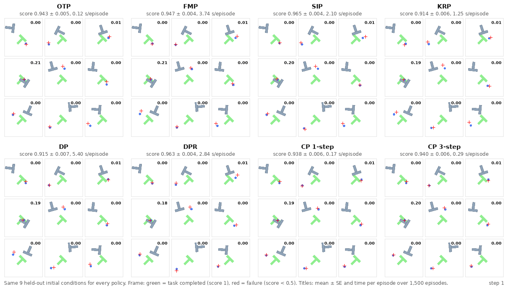

# Conditional Optimal Transport and Triangular Maps for Imitation Learning

Mohammad Al-Jarrah, Yuhang Mei, Karen Leung, Bamdad Hosseini, Amirhossein Taghvaei
(University of Washington). Submitted to L4DC 2027.



*The eight policies of the paper on the same nine held-out Push-T episodes. Green frame: the task
is completed (score 1); red frame: failure (score below 0.5). Titles: mean score and time per
episode over the 1,500 evaluation episodes of Table 2.*

We formulate imitation learning from demonstrations as a conditional sampling problem solved by
triangular transport: a policy is the second block of a triangular map that transports a
reference distribution to the conditional distribution of the action chunk given the observation
history. Unlike in Diffusion Policy, where it is a fixed Gaussian, the reference is a design
variable; we take it to be the empirical distribution of the demonstrated action chunks, P_A, and
introduce three instances of the formulation:

| Policy | Construction of the map | Network evaluations per chunk |
|---|---|---|
| **OTP**, optimal transport policy | conditional optimal transport map, max-min formulation | 1 |
| **FMP**, flow matching policy | flow of a velocity field trained by conditional flow matching | 200 (100 Heun steps) |
| **SIP**, stochastic interpolant policy | SDE of a stochastic interpolant (drift and denoiser) | 200 (100 stochastic Heun steps) |

They are compared with four policies whose reference is a Gaussian: **KRP** (Knothe–Rosenblatt
policy, the stochastic map filter of Spantini et al., 2022), **DP** (Diffusion Policy, Chi et al.,
2023), **DPR** (the training objective of DP on the residual network and integrator of FMP and
SIP), and **CP** (Consistency Policy, Prasad et al., 2024, with one or three sampling steps), on
the state-based Push-T and robomimic Square tasks.

## Repository layout

```
├── README.md
├── environment_pusht.yml      conda environment for Push-T
├── environment_square.yml     conda environment for Square (robosuite 1.2.0, robomimic 0.2.0)
├── experiment.py              train / evaluate one policy on one task (used by scripts and notebooks)
├── visualization.py           GIFs and plots of rollouts
├── policies/                  the seven policies, one file each, with one interface
│   ├── otp.py  fmp.py  sip.py         proposed policies (reference P_A)
│   ├── krp.py  dp.py  dpr.py  cp.py   Gaussian-reference policies
│   ├── common.py              residual MLP, time embedding, learning-rate schedule, EMA, state noise
│   ├── unet.py                1-D temporal U-Net of Diffusion Policy (DP and CP)
│   └── agent.py               deployment: normalization, reference sampling, checkpoints
├── envs/
│   ├── pusht/task.py          Push-T data, training pairs, rollouts (vendored environment in vendored/)
│   └── square/task.py         Square data, training pairs, rollouts
├── configs/
│   ├── pusht.py               hyperparameters of every policy on Push-T (Table 2)
│   └── square.py              hyperparameters of every policy on Square (Table 3)
├── tuning/search_spaces.py    SMAC3 search spaces; their defaults are the settings of configs/
├── scripts/
│   ├── download_data.sh       demonstration data sets
│   ├── train.py               train policies, save checkpoints
│   ├── evaluate.py            evaluate checkpoints on held-out episodes
│   ├── tune.py                hyperparameter search with SMAC3
│   ├── summarize_results.py   Tables 2 and 3, paired bootstrap
│   ├── reproduce_paper.sh     the full protocol of the paper
│   └── figures/make_pusht_gif.py   the GIF above
├── notebooks/
│   ├── 01_pusht_single_policy.ipynb   train, evaluate and visualize one policy on Push-T
│   ├── 02_square_single_policy.ipynb  the same on Square
│   └── 03_compare_policies.ipynb      score against time per episode, from results/
└── assets/pusht_rollouts.gif
```

Data (`data/`), checkpoints (`checkpoints/<task>/<policy>[_noise]_seed<k>.pt`) and evaluation
results (`results/<task>/`) are created locally and are not part of the repository.

## Installation

**Push-T** (Python 3.11):

```bash
conda env create -f environment_pusht.yml
conda activate transport-pusht
bash scripts/download_data.sh pusht          # data/pusht/pusht_cchi_v7_replay.zarr
```

**Square** (Python 3.10). robosuite 1.2.0, the version used by Diffusion Policy, runs on
`mujoco_py` (MuJoCo 2.1), which is installed after the environment is created:

```bash
conda env create -f environment_square.yml
conda activate transport-square
pip install free-mujoco-py==2.1.6
ln -s libOSMesa32.so.8 $CONDA_PREFIX/lib/libOSMesa.so
export LIBRARY_PATH=$CONDA_PREFIX/lib
export LD_LIBRARY_PATH=$CONDA_PREFIX/lib:$CONDA_PREFIX/lib/python3.10/site-packages/mujoco_py/binaries/linux/mujoco210/bin:$LD_LIBRARY_PATH
python -c "import mujoco_py"                 # compiles the extension once
pip install --no-deps robosuite==1.2.0 robomimic==0.2.0
bash scripts/download_data.sh square         # data/square/ph/low_dim_abs.hdf5
```

The two `export` lines are needed in every new shell that runs Square. A GPU is recommended for
training; the evaluation also runs on the CPU.

## Quick start

All commands run from the repository root.

```bash
# train OTP on Push-T (about 10 minutes on one GPU) and evaluate it on 50 held-out episodes
python scripts/train.py --task pusht --policy otp --seed 0
python scripts/evaluate.py --task pusht --policy otp --seed 0 --n-episodes 50

# several policies and seeds at once
python scripts/train.py --task pusht --policy fmp sip --seed 0 1 2

# CP: one checkpoint, evaluated with one or three sampling steps
python scripts/evaluate.py --task pusht --policy cp --seed 0 --cp-steps 3

# Square: the two modifications of Table 3
python scripts/train.py --task square --policy sip --seed 0 --state-noise
python scripts/evaluate.py --task square --policy sip --seed 0 --state-noise --mean-of 8 --workers 12
```

`evaluate.py` prints the mean score with its standard error, the success rate (score 1), the
failure rate (score below 0.5) and the time per episode, and saves the per-episode scores to
`results/<task>/`. `python scripts/<script>.py --help` lists all options.

**Notebooks.** `notebooks/01_pusht_single_policy.ipynb` trains (or loads) one policy chosen in its
first cell, evaluates it, and shows a GIF of nine episodes, their final configurations and the
action chunks sampled for one observation. `02_square_single_policy.ipynb` does the same on Square
(run it in the Square environment), and `03_compare_policies.ipynb` plots the score against the
time per episode for all evaluated policies.

## Reproducing the paper

```bash
bash scripts/reproduce_paper.sh pusht        # Table 2
bash scripts/reproduce_paper.sh square       # Table 3
python scripts/summarize_results.py --task pusht --bootstrap dp
```

The protocol: every policy is trained with seeds 0, 1 and 2 and evaluated on the 500 held-out
episodes 10000–10499 (1,500 episodes per policy). At every query, the policy receives the last
h_o observations and returns a chunk of h_p actions, of which the first h_a are executed (clipped
to the range of the demonstrations); a new reference sample is drawn for every chunk. The
horizons and all other settings are in `configs/`. Training takes from minutes (OTP, FMP, SIP,
KRP, DPR on Push-T) to several hours (DP and CP) per seed on one GPU, and the script skips the
steps whose outputs already exist. A training seed fixes every random draw of the training and
of the evaluation (the reference samples and the sampling noise are seeded by the episode).
On other GPUs or library versions, and with the nondeterministic GPU kernels of the convolutions
of DP and CP, results can differ at the level of floating-point rounding, which changes
individual episodes but not the statistics.

Results of the paper (score on Push-T, success rate on Square; mean ± standard error):

| Policy | Push-T | Time [s] | Square, plain | Square, mean of 8 | Square, state noise | Square, both |
|---|---|---|---|---|---|---|
| OTP | 0.943 ± 0.005 | 0.12 | 0.768 ± 0.011 | 0.871 ± 0.009 | 0.841 ± 0.009 | 0.895 ± 0.008 |
| FMP | 0.947 ± 0.004 | 3.74 | 0.856 ± 0.009 | 0.865 ± 0.009 | 0.907 ± 0.008 | 0.901 ± 0.008 |
| SIP | 0.965 ± 0.004 | 2.10 | 0.913 ± 0.007 | 0.897 ± 0.008 | 0.936 ± 0.006 | 0.921 ± 0.007 |
| KRP | 0.914 ± 0.006 | 1.25 | 0.753 ± 0.011 | 0.721 ± 0.012 | 0.821 ± 0.010 | 0.761 ± 0.011 |
| DP | 0.915 ± 0.007 | 5.40 | 0.938 ± 0.006 | 0.939 ± 0.006 | 0.953 ± 0.005 | 0.947 ± 0.006 |
| DPR | 0.963 ± 0.004 | 2.84 | 0.896 ± 0.008 | 0.891 ± 0.008 | 0.942 ± 0.006 | 0.935 ± 0.006 |
| CP 1-step | 0.938 ± 0.006 | 0.17 | 0.879 ± 0.008 | 0.880 ± 0.008 | 0.889 ± 0.008 | 0.900 ± 0.008 |
| CP 3-step | 0.940 ± 0.006 | 0.29 | 0.887 ± 0.008 | 0.881 ± 0.008 | 0.897 ± 0.008 | 0.901 ± 0.008 |

Checkpoints are not distributed; `scripts/train.py` (or `scripts/reproduce_paper.sh`) produces them.

## Hyperparameter search

The settings of OTP, FMP, SIP, KRP and DPR in `configs/` were selected with SMAC3 (Lindauer et
al., 2022); DP and CP use the published settings of their authors.

```bash
python scripts/tune.py --task pusht --policy fmp                     # 4-hour search (default)
python scripts/tune.py --task square --policy sip --walltime-hours 8
```

A trial trains the policy with a sampled configuration and is scored by its mean score on the
tuning episodes 0–49, which are disjoint from the held-out episodes. The search spaces are in
`tuning/search_spaces.py`; for both tasks, their default configuration, evaluated first, is the
best configuration found for the paper (the settings in `configs/`).

## Citation

```bibtex
@inproceedings{aljarrah2027conditional,
  title     = {Conditional Optimal Transport and Triangular Maps for Imitation Learning},
  author    = {Al-Jarrah, Mohammad and Mei, Yuhang and Leung, Karen and Hosseini, Bamdad and Taghvaei, Amirhossein},
  booktitle = {Submitted to the Learning for Dynamics and Control Conference (L4DC)},
  year      = {2027}
}
```

## License and acknowledgments

The code is released under the MIT license (`LICENSE`). The Push-T environment in
`envs/pusht/vendored/` and the demonstration data are from Diffusion Policy (Chi et al., 2023;
MIT license, `envs/pusht/vendored/LICENSE_diffusion_policy`); the Square task is from robomimic
(Mandlekar et al., 2021) and robosuite (Zhu et al., 2020).

The code of this repository was organized, documented, and tested with the assistance of
[Claude Code](https://claude.com/claude-code) (Anthropic), which was also used to set up and run
the experiments; the methods, the experimental design, and the results were verified by the authors.
